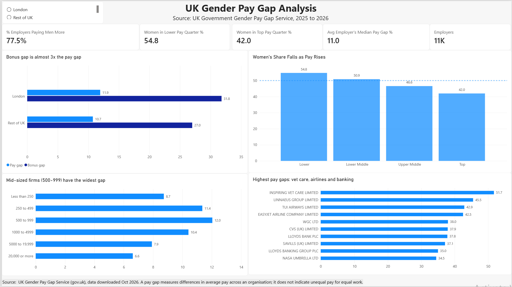

# Climbing the Pay Ladder: UK Gender Pay Gap Analysis

An interactive Power BI dashboard analysing gender pay gap data reported by 11,000 UK employers to the UK Government Gender Pay Gap Service (2025–26 reporting year).

## The question
Where do women lose ground in UK pay, and how does the gap vary by location and employer size?

## Key insights
- **Women's share falls as pay rises.** Women make up 54.8% of the lowest-paid quarter of employees but only 42.0% of the highest-paid quarter, dropping below parity from the upper-middle quarter upwards.
- **77.5% of employers pay men more** (positive median hourly pay gap).
- **The bonus gap is almost 3× the pay gap.** In London, the median bonus gap is 31.8% vs a pay gap of 11.9%; in the rest of the UK, 27.0% vs 10.7%.
- **Mid-sized firms have the widest gap.** Employers with 500–999 staff average a 12.0% median pay gap, compared with 6.6% for employers with 20,000+ staff.
- **The largest individual gaps** are concentrated in veterinary care, airlines and banking.

## What I did
- **Data preparation (Power Query):** cleaned the raw dataset, created a Location field (London / Rest of UK), and added a sort order for employer size bands.
- **Data modelling:** unpivoted the four pay-quartile columns into a separate table so quartiles could be compared on a single axis, with a custom sort order (Lower → Top).
- **DAX measures:** % of employers paying men more, average median pay gap, median bonus gap, women's share per pay quartile, employer count.
- **Visual design:** finding-led chart titles, consistent data labels, a 50% parity reference line, and slicers for interactive filtering.

## Tools
Power BI Desktop · Power Query · DAX

## Limitations
- The "average median pay gap" is a simple average across employers, so a 250-person firm carries the same weight as a 20,000-person firm.
- Data is self-reported by employers. Reporting is mandatory only for organisations with 250+ employees; smaller firms included here reported voluntarily.
- The Location slicer does not currently filter the pay-quartile chart.

## Data & disclaimer
Source: [UK Government Gender Pay Gap Service](https://gender-pay-gap.service.gov.uk/), 2025–26 reporting year, downloaded October 2026.

A pay gap measures the difference in average pay between men and women across a whole organisation. It is not the same as unequal pay for equal work, and gaps often reflect workforce structure (for example, more men in senior roles). Figures are presented as reported and are not a judgement of any individual employer.

## Files
- [UK Gender pay gap dashboard.pbix](UK%20Gender%20pay%20gap%20dashboard.pbix): Power BI file (download and open in Power BI Desktop)
- [dashboard.png](dashboard.png): dashboard screenshot
- [PDF dashboard.pdf](PDF%20dashboard.pdf): static PDF export

## Author
Zufishaa ayub
 [LinkedIn](https://www.linkedin.com/in/zufishaa-ayub-19b515248) 
